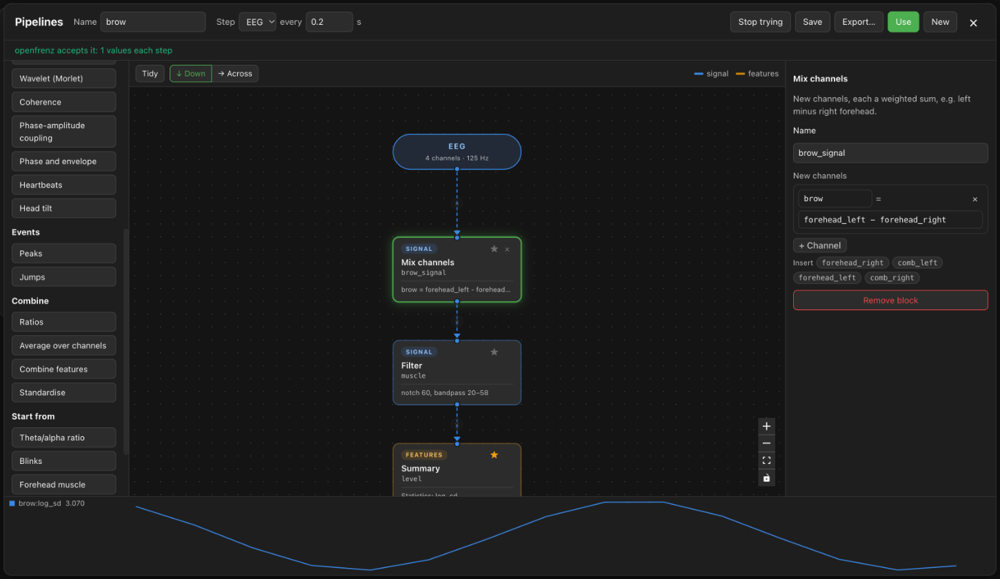
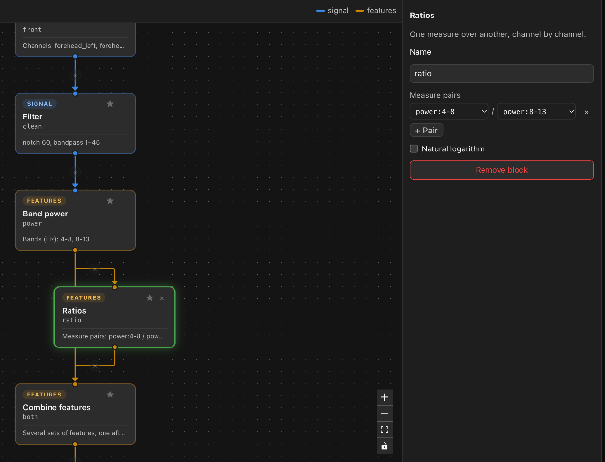

# HyperStudy Bridge

[HyperStudy Bridge](https://github.com/hyperstudyio/hyperstudy-bridge) is a desktop app that connects
research devices to [HyperStudy](https://hyperstudy.io) experiments. It can connect to a FRENZ band through
openfrenz: it publishes the band's streams and the built-in models' outputs over Lab Streaming Layer (LSL),
draws them live, and has an editor for building pipelines as a graph. This page covers what it does with
openfrenz; the [Bridge's FRENZ guide](https://docs.hyperstudy.io/devices/frenz) covers setting it up.

## Live view


Each stream is published as `<band>_<STREAM>` (for example `FRENZI85_EEG`) and each model as
`<band>_<MODEL>_openfrenz`, with the model's name, version and file fingerprint in the stream's metadata.
The live view draws the band's signals and every model's outputs as they arrive.

## Pipelines as a graph

The Bridge's pipeline editor draws a [pipeline](MODELS.md#pipelines-models-as-data) as blocks joined by wires:
streams at the top, each block below the blocks it reads. What it saves is an ordinary `config.json`, so a
pipeline made there runs anywhere openfrenz does, and any pipeline that uses the blocks below can be opened
there.



- **Checked as it changes.** Every edit is turned into a `config.json` and built with
  `Pipeline::from_config`, which checks it as `Pipeline::from_dir` would; the editor shows what it gives each
  step, or openfrenz's message and the node at fault.
- **Names offered.** openfrenz names what each node gives (channels for a signal, features such as
  `forehead_left:power:4-8`), so settings that take names offer them: channels and statistics as chips, pairs
  as dropdowns. A `mix` is written as a formula, such as `(forehead_left + forehead_right) / 2 - comb_left`,
  and saved as its weights.
- **Wires by kind.** A signal (blue) feeds signal blocks, features (amber) feed feature blocks; a wire that
  cannot work is refused with the reason, before openfrenz is asked.
- **Tried on the band.** A pipeline can be run on the connected band and drawn without being published.



The editor offers the blocks that need no stored numbers: `select`, `mix`, `filter`, `band_power`,
`envelope`, `summary`, `quality`, `wavelet`, `coherence`, `coupling`, `phase_amplitude`, `heart`, `tilt`,
`peaks`, `jumps`, `ratios`, `average`, `concat` and `normalize` (tracking its own scale). A pipeline that
uses stored numbers (`asr`, `history`, `network`, or `normalize` with `weights`) can still be opened: those
nodes are shown, the wires around them can change, and their `model.safetensors` is kept when it is saved.

{ width="300" }

The editor keeps its own notes under an `editor` key in `config.json` (where each node is drawn, and which
built-in a copy replaces). openfrenz ignores keys it does not know, so these files load unchanged.

## Built-in models

The Bridge never changes the built-in models (`eog`, `brow-emg`, `heart`, `head`, `eeg-power`). Opening one
in the editor gives an editable copy; using the copy runs it in the built-in's place, under the same name and
on the same LSL stream, until it is reverted.


## Moving pipelines

A pipeline leaves the Bridge as a folder: `config.json`, a short model card (`README.md`), and
`model.safetensors` if it has stored numbers. That is the form every openfrenz loader takes:

=== "Python"

    ```python
    import openfrenz
    model = openfrenz.Pipeline("path/to/my-pipeline")
    ```

=== "Rust"

    ```rust
    let model = frenz_model::Pipeline::from_dir(std::path::Path::new("path/to/my-pipeline"))?;
    ```

Upload the folder to a Hugging Face model repository to [share it](MODELS.md#share-a-model-on-hugging-face).
The Bridge runs models from Hugging Face by name (`owner/name`, with a read token for private ones) and
imports a downloaded or exported `config.json` back into its editor.
