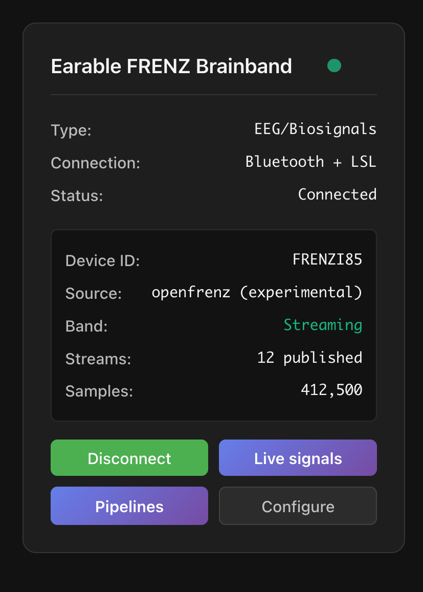
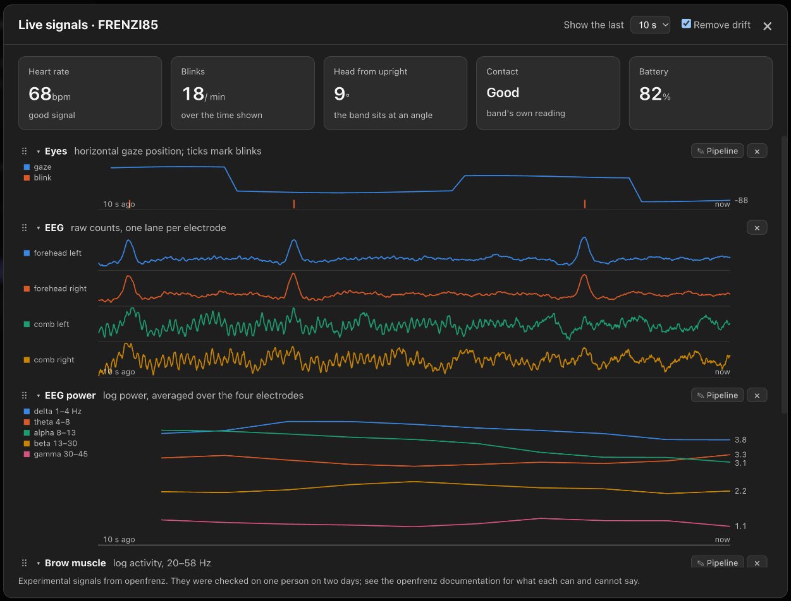
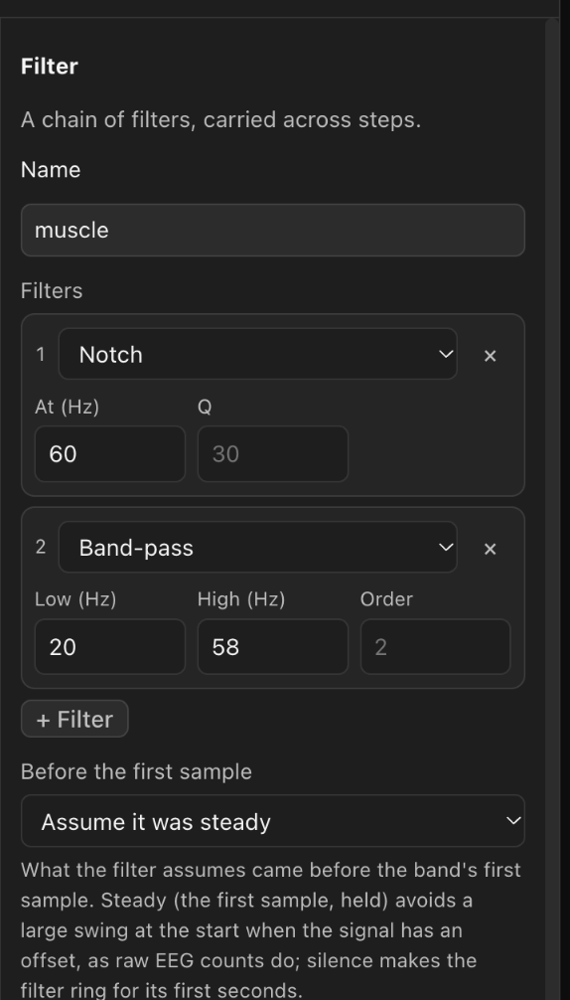
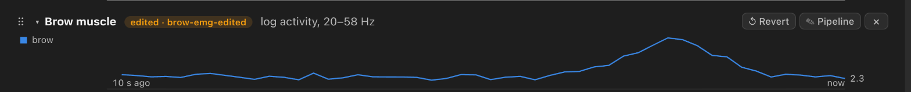

# HyperStudy Bridge

[HyperStudy Bridge](https://github.com/hyperstudyio/hyperstudy-bridge) is a desktop app that connects
research devices to [HyperStudy](https://hyperstudy.io) experiments. It can connect to a FRENZ band through
openfrenz, with no code to write:

- it [streams the band to Lab Streaming Layer (LSL)](#streaming-to-lsl), raw signals and model outputs alike,
  for HyperStudy, LabRecorder or any LSL reader;
- it draws everything in a [real-time dashboard](#real-time-dashboard);
- it has a [graph editor](#pipelines-as-a-graph) for building pipelines, tried on the band as you build them.

This page covers what it does with openfrenz; the [Bridge's FRENZ guide](https://docs.hyperstudy.io/devices/frenz)
covers installing and setting it up. [Download the Bridge](https://github.com/hyperstudyio/hyperstudy-bridge/releases)
for macOS, Windows or Linux.

## Streaming to LSL

In the Bridge, set the FRENZ device's **Connection** to **openfrenz**, enter the band's name and press
**Connect**. The card shows the band's state and how many streams and samples have been published.

{ width="320" }

Each of the band's streams and each model becomes one LSL stream, named after the band so that two bands never
collide. With a band called `FRENZI85`:

| LSL stream | Channels | Rate |
|---|---|---|
| `FRENZI85_EEG` | `forehead_right`, `comb_left`, `forehead_left`, `comb_right` | 125 Hz |
| `FRENZI85_ACCEL`, `FRENZI85_GYRO` | `x`, `y`, `z` | 50 Hz |
| `FRENZI85_PPG` | `tag2`, `tag3` | 25 Hz |
| `FRENZI85_HR`, `FRENZI85_SPO2` | `value`, `check` | as the band sends them |
| `FRENZI85_CONTACT` | `state` (0–3, 3 is good contact) | as the band sends it |
| `FRENZI85_EOG_openfrenz` | the [`eog` model](MODELS.md#eye-and-brow-signals)'s outputs | every 0.2 s |
| `FRENZI85_BROW_EMG_openfrenz` | the `brow-emg` model's outputs | every 0.2 s |
| `FRENZI85_HEART_openfrenz` | the [`heart` model](MODELS.md#heart-rate-and-its-variability)'s outputs | every 5 s |
| `FRENZI85_HEAD_openfrenz` | the [`head` model](MODELS.md#head-posture-and-movement)'s outputs | every second |
| `FRENZI85_EEG_POWER_openfrenz` | the [`eeg-power` model](MODELS.md#eeg-power-bands)'s outputs | every second |

A pipeline added in the Bridge (from Hugging Face, or built in its editor) is published the same way, as
`<band>_<NAME>_openfrenz`. Model streams are declared with an irregular rate, one sample per step.

- **Values** are 64-bit floats: raw device counts for the band's streams (as openfrenz gives them; see
  [Hardware notes](HARDWARE.md)), and the units this site documents for model outputs. Channel labels are the
  stream's or model's names.
- **Time stamps** are openfrenz's estimate of when each sample was taken, in Unix seconds, moved to the
  computer's LSL clock with one offset measured when the connection opened. Repeated packets are left out.
- **Metadata** in each stream's description: `device_id`, `session_id`, `openfrenz_source` (the stream, or the
  model's name and version, with its files' fingerprint for a model from a folder or Hugging Face), `timestamp_policy` (`source_unix`) and
  `source_unix_to_lsl_offset`, so a recording can always say what produced it.
- **Source ids** are `frenz-<band>-<session>_<STREAM>`: a new connection gets a new session, and a model
  replaced while connected keeps its stream and source id, so a reader carries on.

Any LSL reader can take them, for example with `pylsl`:

```python
from pylsl import StreamInlet, resolve_byprop

info = resolve_byprop("name", "FRENZI85_EOG_openfrenz", timeout=5)[0]
inlet = StreamInlet(info)
values, stamp = inlet.pull_sample()          # one step of the eog model
```

## Real-time dashboard

**Live signals** on the card opens a dashboard of the band's signals and every model's outputs, redrawn several
times a second. Nothing in it changes what is published or recorded.



- **Tiles** at the top: heart rate (with whether the pulse signal is good enough to trust), blinks a minute, how
  far the head is from upright, electrode contact and battery.
- **Charts** below: the four electrodes in their own lanes, EEG power by band, eye position with blinks marked,
  forehead muscle, head angle and the pulse, plus a chart for every model added. Drag a chart to reorder it,
  collapse it, or hide it and bring it back; the layout is remembered.
- **Show the last** 5, 10 or 30 seconds, and **Remove drift** to subtract each trace's one-second average from
  the drawing.
- **✎ Pipeline** on a model's chart opens that model in the editor, and **+ New signal** starts a new one.

## Pipelines as a graph

The Bridge's pipeline editor draws a [pipeline](MODELS.md#pipelines-models-as-data) as blocks joined by wires:
streams at the top, each block below the blocks it reads. What it saves is an ordinary `config.json`, so a
pipeline made there runs anywhere openfrenz does, and any pipeline that uses the blocks below can be opened
there.


- **Checked as it changes.** Every edit is turned into a `config.json` and built with
  `Pipeline::from_config`, which checks it as `Pipeline::from_dir` would; the editor shows what it gives each
  step, or openfrenz's message and the node at fault.
- **Names offered.** openfrenz names what each node gives (channels for a signal, features such as
  `forehead_left:power:4-8`), so settings that take names offer them: channels and statistics as chips, pairs
  as dropdowns. A `mix` is written as a formula, such as `(forehead_left + forehead_right) / 2 - comb_left`,
  and saved as its weights.
- **Wires by kind.** A signal (blue) feeds signal blocks, features (amber) feed feature blocks; a wire that
  cannot work is refused with the reason, before openfrenz is asked.
- **Tried on the band.** A pipeline can be run on the connected band and drawn without being published.


The editor offers the blocks that need no stored numbers: `select`, `mix`, `filter`, `band_power`,
`envelope`, `summary`, `quality`, `wavelet`, `coherence`, `coupling`, `phase_amplitude`, `heart`, `tilt`,
`peaks`, `jumps`, `ratios`, `average`, `concat` and `normalize` (tracking its own scale). A pipeline that
uses stored numbers (`asr`, `history`, `network`, or `normalize` with `weights`) can still be opened: those
nodes are shown, the wires around them can change, and their `model.safetensors` is kept when it is saved.

{ width="300" }

The editor keeps its own notes under an `editor` key in `config.json` (where each node is drawn, and which
built-in a copy replaces). openfrenz ignores keys it does not know, so these files load unchanged.

## Built-in models

The Bridge never changes the built-in models (`eog`, `brow-emg`, `heart`, `head`, `eeg-power`). Opening one
in the editor gives an editable copy; using the copy runs it in the built-in's place, under the same name and
on the same LSL stream, until it is reverted.



## Moving pipelines

A pipeline leaves the Bridge as a folder: `config.json`, a short model card (`README.md`), and
`model.safetensors` if it has stored numbers. That is the form every openfrenz loader takes:

=== "Python"

    ```python
    import openfrenz
    model = openfrenz.Pipeline("path/to/my-pipeline")
    ```

=== "Rust"

    ```rust
    let model = frenz_model::Pipeline::from_dir(std::path::Path::new("path/to/my-pipeline"))?;
    ```

Upload the folder to a Hugging Face model repository to [share it](MODELS.md#share-a-model-on-hugging-face).
The Bridge runs models from Hugging Face by name (`owner/name`, with a read token for private ones) and
imports a downloaded or exported `config.json` back into its editor.
